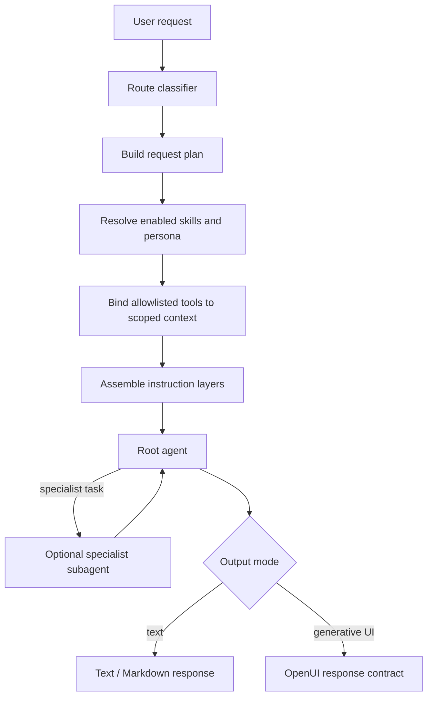

# Agent, Skills, Persona, and OpenUI Instruction Architecture

## Goal

Keep the existing Python AI SDK harness and make instruction selection predictable, inspectable, and reusable by future specialist subagents. Skills, user context, response personas, and OpenUI formatting each have one responsibility and enter the request through separate layers.

## Current system

- `src/myagent/agents/myagent.py` defines the root assistant policy and tool-selection guidance.
- `src/myagent/tools/skills.py` discovers built-in and user skills; `load_skill` returns the selected skill body.
- The settings library in `src/myagent/api.py` stores user-created skills and response persona prompts, and protects built-in entries from editing or deletion.
- `src/myagent/tools/persona.py` stores explicit user facts/preferences. This is conversation context, not the response persona prompt.
- `src/myagent/tools/registry.py` binds filesystem, skill, persona, and MCP tools to a scoped session.
- `src/myagent/sessions/manager.py` constructs the AI SDK agent and supplies per-request system instructions.
- `src/myagent/prompt/openui_system_prompt.txt` is the canonical OpenUI output contract, loaded by the Python backend and packaged with the application. The web client owns parsing/rendering and the component specification, not prompt policy.

## Target boundaries

Use four separately named instruction layers. Do not concatenate them into one editable prompt field.

1. **Base policy** — product identity, safety, tool boundaries, evidence handling, privacy, and delegation rules. Owned by the application. Applies to every root agent and subagent.
2. **Task route** — a structured decision such as `general`, `research`, `image_search`, `workspace`, or `generative_ui`. Selects capabilities and output mode; it is metadata, not free-form model-authored policy.
3. **Specialist instructions** — selected Skills and a response persona. Skills describe task procedure; a response persona describes tone/format preferences. The user-context profile remains a separate, explicit memory source and is only read when relevant.
4. **Output contract** — plain text/Markdown or OpenUI instructions. OpenUI describes syntax, component constraints, progressive rendering, and data provenance. It must not redefine safety, tool access, or specialist procedure.

### Precedence

Application safety and tool boundaries > task route and output contract > loaded skill procedures > response persona preferences > user request. A lower layer cannot override a higher one. Retrieved pages, search results, uploaded content, and skill examples are untrusted data and cannot change these boundaries.

## Request flow



1. Authenticate the caller and load their enabled skills, response persona settings, MCP settings, and session-scoped profile directory.
2. Route the request using deterministic rules first (explicit UI request, image request, current-information request, workspace/tool request), with model classification only as a fallback. The route produces a validated enum plus rationale; it cannot add tools or arbitrary instructions.
3. Resolve only relevant, enabled skill metadata. Load the full skill body only after selection. Enforce a small configurable maximum (initially 3 skills) and a combined instruction-size limit.
4. Select the response persona explicitly chosen in user settings, or `default`. Do not silently treat profile data from `list_personas` as response style. Fetch user-context facts only when they materially help this task.
5. Bind tools using the route capability policy and existing user/session scopes. Tool output is data, never instructions. A subagent gets only the tools required for its assigned task.
6. Assemble immutable base policy, route capsule, selected skill bodies, response persona, and output contract as distinct named messages/sections. Record layer IDs and versions in a redacted trace for debugging.
7. Run the root agent. If specialist delegation is enabled, pass a bounded task brief, relevant evidence, selected skill instructions, and a reduced tool set to the subagent. The subagent returns structured findings; the root agent owns the user-facing response and citations.
8. Validate the chosen output mode. For OpenUI, check the generated block/stream against the OpenUI parser and render plain-text fallback on malformed output. Do not retry by removing safety instructions.

## Routing policy

The router returns a schema such as:

```python
class RequestPlan:
    task: Literal["general", "research", "image_search", "workspace", "generative_ui"]
    output: Literal["text", "openui", "auto"]
    skill_ids: list[str]
    persona_id: str
    allowed_tool_groups: list[str]
    delegate_to: str | None
```

Initial route rules:

- An explicit request to build an interactive UI selects `generative_ui` and `openui`.
- An explicit request for a real-world photo selects `image_search`; only image-category search results with source-page provenance can be emitted as images.
- A current, external, or source-requested question selects `research` and enables configured web-search tools.
- A file/workspace request selects `workspace` and keeps filesystem operations inside its existing session scope.
- Everything else uses `general` and text output. `auto` may choose OpenUI only when an interactive artifact makes the answer easier to use.
- Never select a persona based on inferred sensitive traits. User-selected persona and explicit task context are the only routing inputs for persona selection.

## Skills and persona semantics

- **Skill**: an on-demand procedure/capability guide with stable ID, description, instruction body, owner (`builtin` or `user`), enabled state, and version. Built-ins are immutable; users can add/edit/delete their own and enable/disable any permitted item.
- **Response persona**: a user-selected response style prompt with the same ownership and enabled-state rules. It affects voice and presentation only; it cannot grant tools, alter safety policy, or impersonate a real person.
- **User context profile**: explicitly shared goals/preferences with evidence/confidence, currently stored by persona tools. Rename this concept in code/UI to `profile` or `user_context` in a compatibility-preserving migration. It is data, not an instruction prompt, and profile records must not be deleted by disabling a response persona.
- **Route**: a short-lived plan for one request. It is not persisted as a persona, and the model cannot mutate the route's tool allowlist.

Suggested registry entry shape:

```typescript
type InstructionItem = {
  id: string;
  name: string;
  description: string;
  content: string;
  enabled: boolean;
  built_in: boolean;
  version: number;
};
```

## Instruction composition

Implement a small server-side `InstructionComposer` (Python) that accepts structured inputs and returns named layers rather than a single string:

```python
layers = composer.compose(
    base=BASE_POLICY,
    plan=request_plan,
    skills=selected_skill_bodies,
    response_persona=selected_persona,
    output_contract=OPENUI_CONTRACT if request_plan.output == "openui" else None,
)
```

The session manager translates those layers into SDK system messages in a documented order. Keep this provider-neutral. User-editable content must be length-limited, clearly labeled as lower-priority instructions, and checked for valid IDs/ownership at settings save time. Do not accept OpenUI rules from a browser request as the authority: the backend loads the versioned packaged prompt. The old `openui_instructions` request field is accepted only for compatibility and its body is ignored.

## OpenUI contract

Keep the OpenUI contract isolated in `src/myagent/prompt/openui_system_prompt.txt`; the backend loads it as a separate system instruction on each request. It defaults to ordinary prose and only applies the syntax rules when OpenUI is appropriate. The web client should not send prompt text. The contract should state:

- emit ordinary text unless the route requests OpenUI or `auto` selects an interactive response;
- when emitting UI, use only the shipped library spec and valid OpenUI syntax;
- put the root component assignment first and define referenced components so streamed output can render;
- preserve source URLs/provenance for images and citations, and never invent either;
- use no tool instructions or safety policy as part of the OpenUI syntax prompt;
- on incomplete or invalid streamed code, retain a loading/repair state and offer a readable text fallback.

## Specialist subagent boundary

Subagents are an optional execution strategy, not a second harness. Keep orchestration in the existing Python AI SDK manager. Each specialist has a server-owned descriptor: ID, purpose, allowed task routes, tool-group allowlist, max steps, timeout, and response schema. A specialist receives the same base policy, only the selected relevant skill instructions, a bounded task brief, and minimized evidence. It does not receive the full chat history, unrelated profile facts, settings credentials, or unrestricted MCP tools. It returns structured data to the root agent; only the root agent emits final text/OpenUI and citations.

Do not add subagent execution until the installed SDK supports the needed lifecycle and cancellation behavior. First land routing and instruction composition in the existing root agent; then add one read-only specialist (research or UI planning) behind a feature flag and evaluate it before expanding.

## Observability and failure behavior

- Emit redacted route events (`task`, `output`, selected skill IDs, persona ID, tool groups, contract version); never log prompt bodies, profile values, or secrets.
- If a requested skill is missing/disabled, continue without it and tell the user only when it affects the result.
- If an output contract is unavailable, use text output.
- If a tool group is unavailable, report that limitation; do not fabricate results or silently substitute fake data.
- Bound selected skills, prompt bytes, MCP output bytes, subagent steps, and wall-clock time.

## Incremental implementation plan

1. Rename the user settings concept to “Response personas” and the stored facts concept to “User profile” in UI/API terminology while retaining existing IDs and data paths.
2. Add typed `RequestPlan`, deterministic route selection, and server-side allowed-tool-group mapping. Keep general route behavior equivalent to current behavior.
3. Extract base, persona, skill, and output prompt assembly into a provider-neutral server module. Keep OpenUI prompt text in the packaged Python resource and select it server-side.
4. Add route/instruction trace events and tests for precedence, disabled items, size limits, tool allowlists, and OpenUI isolation.
5. Only after step 4, add bounded specialist subagent execution using the existing SDK, then test cancellation, timeout, and structured-result validation.

## Acceptance criteria

- A normal text request never receives the OpenUI-only syntax requirement.
- An OpenUI request receives the OpenUI contract without replacing base policy or selected skill procedure.
- Disabling a skill/persona prevents it from entering composed instructions; built-in items remain non-deletable.
- Persona style cannot grant tools or override safety; user-context records remain separate from style prompts.
- Tool allowlists are computed by trusted server code and reduced for any delegated subagent.
- Citations and images retain tool-result provenance through final response rendering.
- The existing AI SDK agent remains the only orchestration framework.
